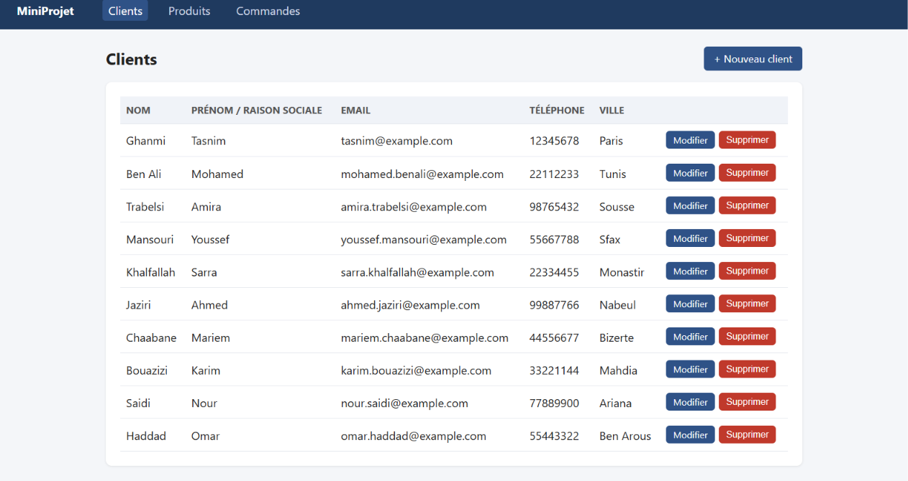
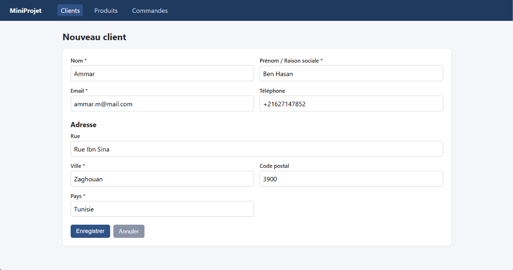
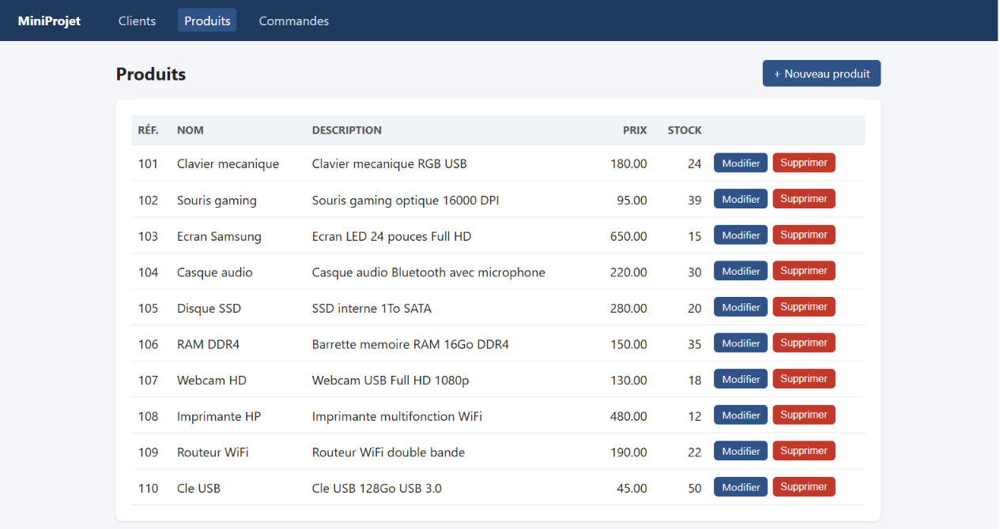
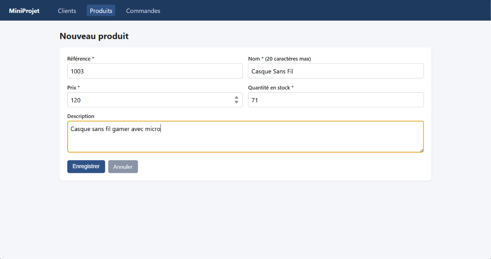
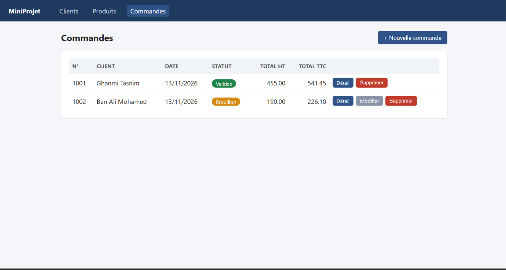
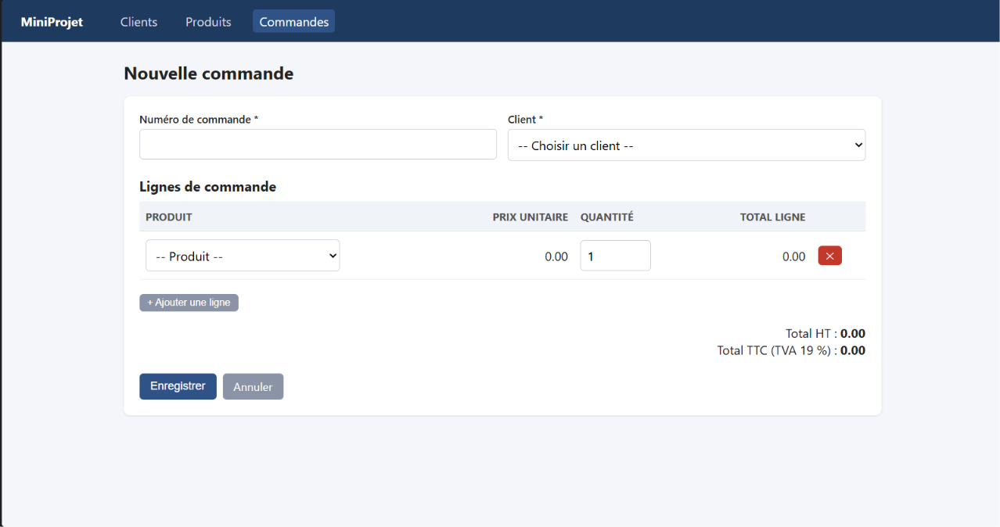
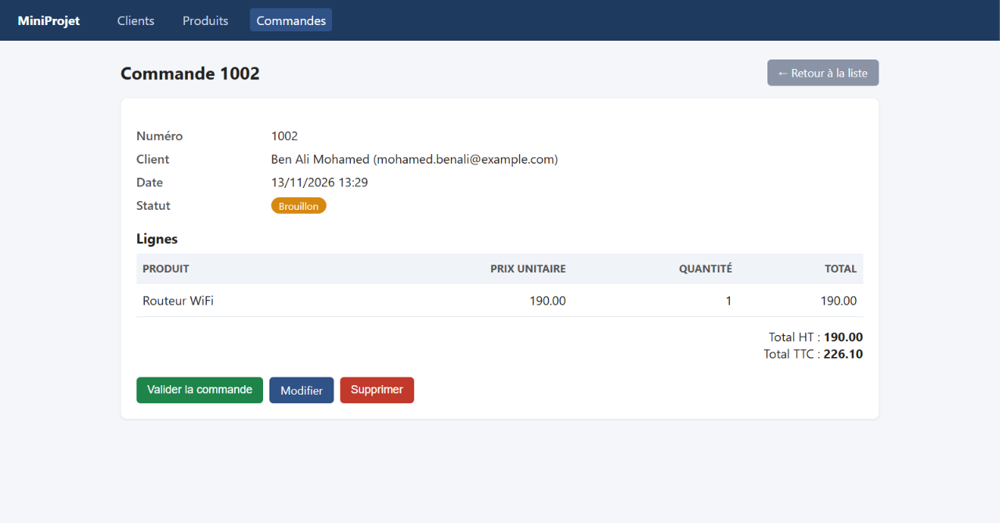

# Gestion clients, produits et commandes

Mini-projet composé d'une API REST (ASP.NET Core 8 + Entity Framework Core + MySQL/MariaDB) et d'une interface Angular.

```
gestion_c.../
├── miniProjet/        # Back-end (API .NET)
├── miniprojet-ui/     # Front-end (Angular)
├── database/          # Script SQL de création de la base
└── screenshots/       # Captures d'écran
```

## Fonctionnalités

- Clients : liste, création, modification, suppression (avec adresse)
- Produits : liste, création, modification, suppression (avec stock)
- Commandes : liste, création, modification, suppression, page de détail
- Validation d'une commande : passage au statut « Validee » et décrémentation du stock
- Calcul automatique des totaux HT et TTC (TVA 19 %) côté API, avec les prix lus en base

## Approche utilisée : Database First

La base de données a été créée en premier, puis les modèles et le `DbContext` ont été générés automatiquement à partir de celle-ci avec Entity Framework Core (approche *Database First*).

1. Installation des packages EF Core dans le projet `miniProjet` :
   ```bash
   dotnet add package Microsoft.EntityFrameworkCore --version 8.0.22
   dotnet add package Pomelo.EntityFrameworkCore.MySql --version 8.0.3
   dotnet add package Microsoft.EntityFrameworkCore.Tools --version 8.0.22
   ```
   - `Microsoft.EntityFrameworkCore` : EF Core
   - `Pomelo.EntityFrameworkCore.MySql` : fournisseur EF Core pour MySQL / MariaDB
   - `Microsoft.EntityFrameworkCore.Tools` : outils EF Core (commandes de scaffolding)

2. Installation de l'outil en ligne de commande `dotnet ef` (une seule fois) :
   ```bash
   dotnet tool install --global dotnet-ef
   ```

3. Génération des modèles et du contexte à partir de la base existante :
   ```bash
   dotnet ef dbcontext scaffold "server=localhost;port=3306;database=miniprojet;user=root;password=;" Pomelo.EntityFrameworkCore.MySql -o Models
   ```
   Les classes générées (`Client`, `Adresse`, `Produit`, `Commande`, `LigneCommande`) et `MiniProjetContext` se retrouvent dans le dossier `Models`.

## Prérequis

- [.NET SDK 8](https://dotnet.microsoft.com/download/dotnet/8.0)
- MySQL ou MariaDB (par exemple via XAMPP), accessible sur `localhost:3306`
- [Node.js](https://nodejs.org/) 22 LTS (avec npm)
- Un navigateur récent

## 1. Base de données

1. Démarrer MySQL / MariaDB.
2. Importer le script de création :
   ```bash
   mysql -u root < database/mini_projet.sql
   ```
   (ou l'ouvrir dans phpMyAdmin / MySQL Workbench et l'exécuter).
3. Vérifier la chaîne de connexion dans `miniProjet/appsettings.json` et l'adapter si besoin (utilisateur, mot de passe, port) :
   ```json
   "ConnectionStrings": {
     "DefaultConnection": "server=localhost;port=3306;database=mini_projet;user=root"
   }
   ```

## 2. Lancer le serveur .NET (back-end)

Le serveur .NET doit être démarré **avant** le front-end et rester allumé pendant toute l'utilisation de l'application.

**Option A : en ligne de commande**
```bash
cd miniProjet
dotnet restore
dotnet run --launch-profile https
```

**Option B : avec Visual Studio**
Ouvrir `miniProjet/miniProjet.sln`, choisir le profil de lancement `https`, puis lancer avec F5 (ou Ctrl+F5).

Une fois le serveur démarré :
- API : https://localhost:7182 (et http://localhost:5069)
- Documentation Swagger : https://localhost:7182/swagger

Si le navigateur signale un certificat non fiable en développement, exécuter une fois `dotnet dev-certs https --trust`.

Routes principales : `/api/clients`, `/api/produit`, `/api/orders` (et `POST /api/orders/{id}/validate`).

## 3. Lancer le front-end

Dans un second terminal, **le serveur .NET étant toujours en cours d'exécution** :

```bash
cd miniprojet-ui
npm install
npm start
```

Ouvrir http://localhost:4200.

L'API n'active pas CORS : le fichier `miniprojet-ui/proxy.conf.json` redirige donc les appels `/api/*` vers `https://localhost:7182`. Si l'API tourne sur un autre port, modifier la valeur `target` dans ce fichier.

## Captures d'écran

### Liste des clients


### Ajout d'un client


### Liste des produits


### Ajout d'un produit


### Liste des commandes


### Création d'une commande


### Détail d'une commande
